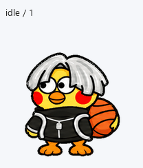

# ikun · 小灰鸡 Pet

灰色中分发、红脸颊、黑衣和篮球的小鸡动画素材，当前为 **左向镜像版**。



## 下载和使用

下载 [spritesheet.png](spritesheet.png) 原始文件，在支持 v2 精灵图的 Pets 流程中将它作为精灵图创建宠物。可对启用了 Pets 插件的助手说：

> 用这张精灵图创建一个名叫“小灰鸡·左向版”的 pet，并选中它。

[pet.json](pet.json) 记录素材尺寸、动作帧数和校验值，便于复用与核对。

## 动作

包含待机、左右走动、招手、小跳、失落、等待输入、思考和检查九种动作，以及十六个注视方向。

这版缩短步幅、减小跳跃和手势幅度，并修正动作裁图居中造成的横向抖动。

- [新版与上一版的对比](previews/before-after.gif)
- [全部动作 MP4](previews/all-states.mp4)
- [待机—跳跃—待机](previews/idle-jump-idle.gif)
- [注视方向循环](previews/look-loop.gif)
- [动作静帧](previews/motion-stills.png)
- [全部帧总览](contact-sheet.png)
- [注视方向总览](direction-sheet.png)
- 每种动作的独立 GIF 位于 [previews/states](previews/states)。

## 素材规格

| 项目 | 规格 |
| --- | --- |
| 格式 | 透明 PNG RGBA |
| 图像尺寸 | 1536 × 2288 像素 |
| 网格 | 8 列 × 11 行 |
| 每格尺寸 | 192 × 208 像素 |
| 有效帧数 | 73 |
| 各行帧数 | 6、8、8、4、5、8、6、6、6、8、8 |

SHA-256：

```text
ba6fbbafa0c32c29e6364ed026235f665827c0209c4c4888fc31627f4b50feb5
```

已通过结构校验、制作质量检查和 Pets 平台校验，简要结果见 [qa](qa)。

## 制作和播放说明

以提供的参考图为基础，使用内置图像生成工具制作和修订，再完成提取、位置校正、去色边与合成。

Pets 当前动作帧数固定。本版改善了姿态衔接；预览播放节奏不能代表应用内实际 FPS，尚未测量应用内掉帧。整只宠物显示或隐藏时的过渡由应用控制。
